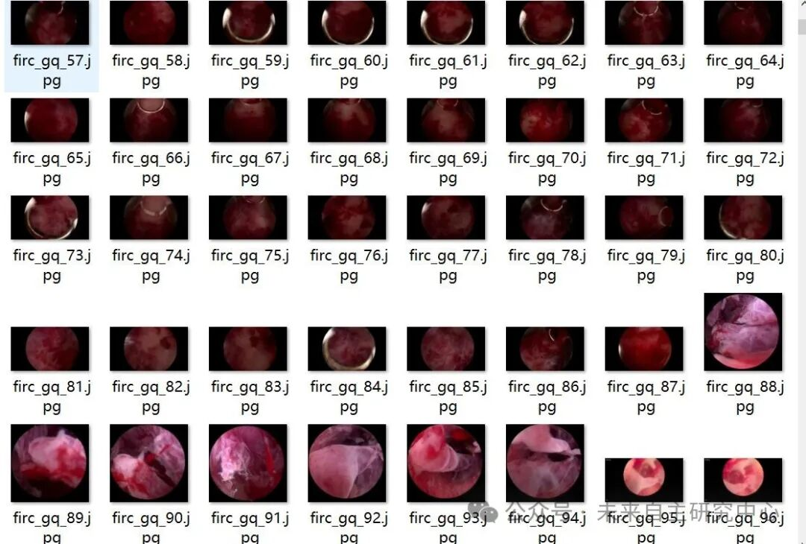
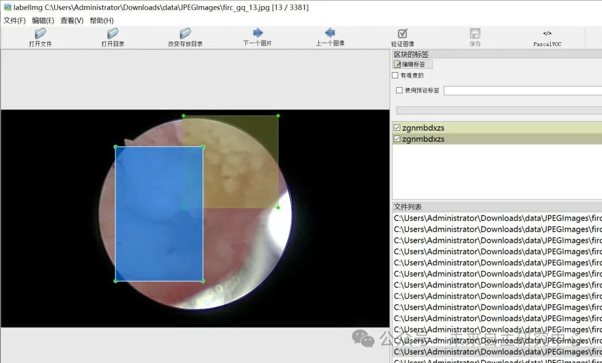

# Intelligent Medical Uterine Endometrial Image Lesion Detection Dataset VOC+YOLO format with 3381 images in 8 categories

Dataset format: Pascal VOC format + YOLO format (txt file without split path, only containing jpg images and corresponding VOC format xml files and yolo format txt files)

Number of images (number of jpg files): 3381

Number of annotations (number of xml files): 3381

Number of annotations (number of txt files): 3381

Annotation Category Count: 8

Label category names (Note that the order of categories in the YOLO format does not correspond to this, but is based on the labels folder's classes.txt): ["gnyw", "nmxzgjl", "zgjxr", "zgnma", "zgnmbdxzs", "zgnmxr", "zgnmxryzs", "zgnmzsbbbdxzs"] => [Intrauterine foreign body, Submucosal Myoma, Cervical Papilloma, Endometrial Cancer, Atypical Endometrial Hyperplasia, Endometrial Polyp, Endometrial Polypoid Hyperplasia, Endometrial Proliferation without Atypical Hyperplasia]

Number of boxes labeled in each category:

gnyw Frame Count = 464

nmxzgjl Frames = 323

zgjxr Frames = 550

zgnma frame count = 352

zgnmbdxzs = 96

zgnmxr Frame Count = 1328

zgnmxryzs = 682

zgnmzsbbbdxzs Frame count = 381

Total frame count: 4176

Using labelImg:

Annotation rules: Draw a rectangle around the category.

Important Notice: No

Special : This dataset does not guarantee the accuracy or precision of the trained models or weight files. The dataset is provided with accurate and reasonable annotations only.

Image Preview:

Annotation example:

## Payment

Here is a pay link on Stripe ( https://buy.stripe.com/3cs8yP7sY87d0vu9AB ). Please contact me lonlonago@foxmail.com after funding $89, and I will send you a complete data files , thank you!

